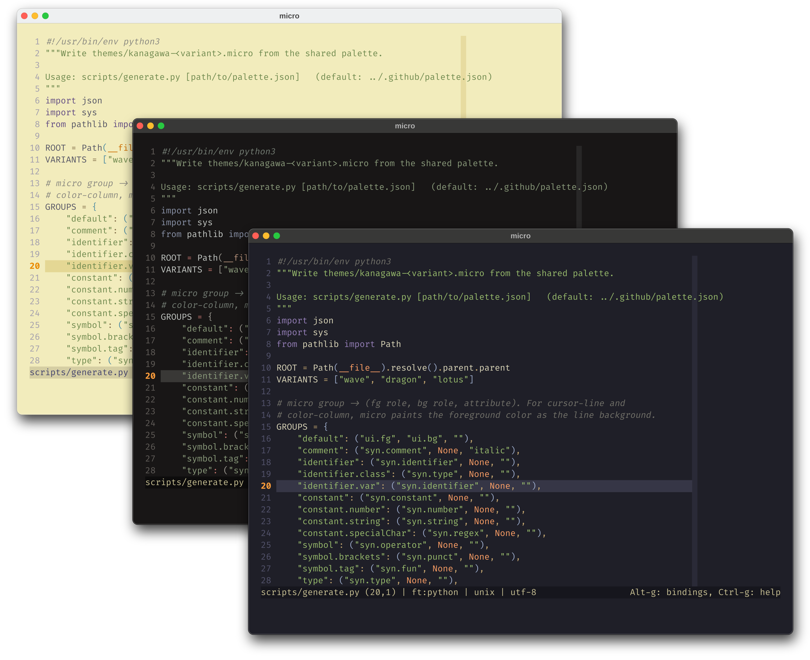
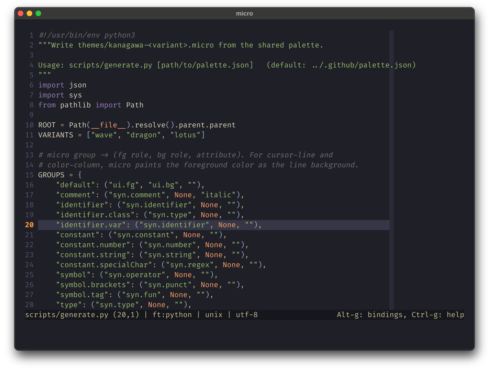
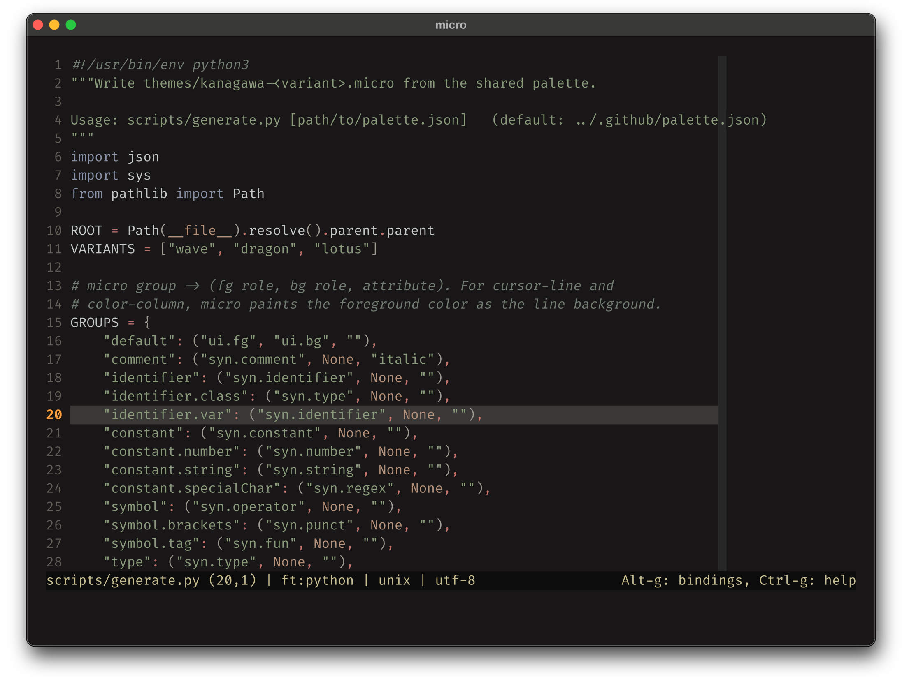
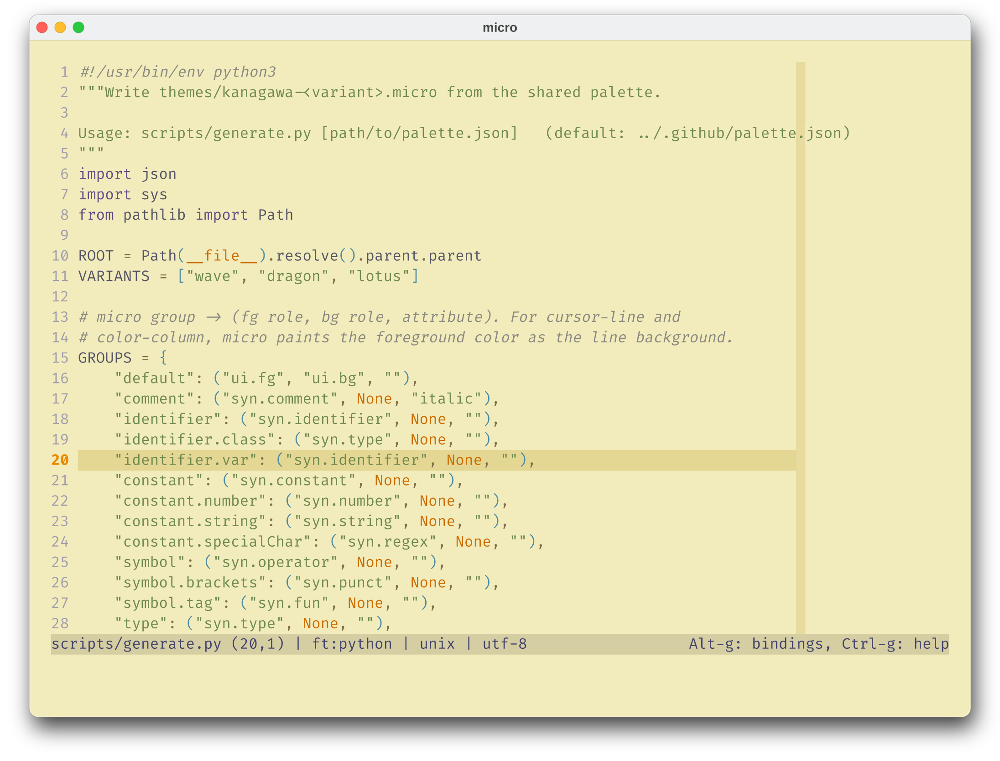

<h3>Kanagawa for <a href="https://micro-editor.github.io/">micro</a></h3>
<p>A community-maintained theme inspired by Hokusai's <em>The Great Wave off Kanagawa</em>.</p>
<p>Using the <a href="https://github.com/rebelot/kanagawa.nvim">Kanagawa palette</a> by <a href="https://github.com/rebelot">Tommaso Laurenzi (rebelot)</a>.</p>

<!-- Wave accents: carpYellow, crystalBlue, autumnRed. Lotus accents: lotusYellow, lotusBlue4, lotusRed. -->
<p>
  <a href="https://github.com/kanagawa-community/micro/stargazers">
    <picture>
      <source media="(prefers-color-scheme: dark)" srcset="https://img.shields.io/github/stars/kanagawa-community/micro?style=for-the-badge&amp;labelColor=1F1F28&amp;color=E6C384">
      <source media="(prefers-color-scheme: light)" srcset="https://img.shields.io/github/stars/kanagawa-community/micro?style=for-the-badge&amp;labelColor=F2ECBC&amp;color=77713F">
      
    </picture>
  </a>
  <a href="https://github.com/kanagawa-community/micro/releases/latest">
    <picture>
      <source media="(prefers-color-scheme: dark)" srcset="https://img.shields.io/github/v/release/kanagawa-community/micro?style=for-the-badge&amp;label=release&amp;labelColor=1F1F28&amp;color=7E9CD8">
      <source media="(prefers-color-scheme: light)" srcset="https://img.shields.io/github/v/release/kanagawa-community/micro?style=for-the-badge&amp;label=release&amp;labelColor=F2ECBC&amp;color=4D699B">
      
    </picture>
  </a>
  <a href="https://github.com/kanagawa-community/micro/issues">
    <picture>
      <source media="(prefers-color-scheme: dark)" srcset="https://img.shields.io/github/issues/kanagawa-community/micro?style=for-the-badge&amp;labelColor=1F1F28&amp;color=C34043">
      <source media="(prefers-color-scheme: light)" srcset="https://img.shields.io/github/issues/kanagawa-community/micro?style=for-the-badge&amp;labelColor=F2ECBC&amp;color=C84053">
      
    </picture>
  </a>
</p>

<br clear="both">
<br>

## Previews



<details>
<summary>🌊 Wave</summary>

</details>

<details>
<summary>🐉 Dragon</summary>

</details>

<details>
<summary>🪷 Lotus</summary>

</details>

## Requirements

- micro 2.0 or later, with a terminal that supports truecolor.

## Installation

Download the three themes into ~/.config/micro/colorschemes:

```sh
mkdir -p ~/.config/micro/colorschemes
for variant in wave dragon lotus; do
  curl -fsSL -o ~/.config/micro/colorschemes/kanagawa-$variant.micro https://raw.githubusercontent.com/kanagawa-community/micro/main/themes/kanagawa-$variant.micro
done
```

Or clone the repository and run `./install.sh`. It installs all three variants,
or only the ones you name, for example `./install.sh dragon lotus`. `./uninstall.sh`
takes the same names and removes them.

## Usage

Set the color scheme in `~/.config/micro/settings.json`:

```json
{ "colorscheme": "kanagawa-wave" }
```

Or run `set colorscheme kanagawa-wave` from micro's command bar (`Ctrl-e`).
micro uses truecolor when `MICRO_TRUECOLOR=1` or `COLORTERM=truecolor` is set.

## Palette

Every color comes from the shared
[palette](https://github.com/kanagawa-community/.github/blob/main/docs/PALETTE.md),
picked by role, so each variant uses its own value for the same role.

| micro color                                     | Palette role                              |
| ----------------------------------------------- | ----------------------------------------- |
| `default`                                       | `ui.fg` on `ui.bg`                        |
| `statusline`, `tabbar`                          | `ui.fg_dim` on `ui.bg_m3`                 |
| `cursor-line`                                   | `ui.bg_p2`                                |
| `color-column`                                  | `ui.bg_p1`                                |
| `line-number`                                   | `ui.nontext`                              |
| `current-line-number`, `todo`, `gutter-warning` | `diag.warning`                            |
| `error`, `gutter-error`                         | `diag.error`                              |
| `indent-char`                                   | `ui.whitespace`                           |
| `diff-added`, `diff-modified`, `diff-deleted`   | `vcs.added`, `vcs.changed`, `vcs.removed` |
| syntax groups                                   | `syn.*`                                   |

Syntax scopes take the role that the Neovim plugin uses for the same thing. `scripts/generate.py` lists every scope.

## Credits

This port replaces the micro theme in the `extras` folder of the
[Neovim plugin](https://github.com/kanagawa-community/neovim). Antônio Camargo first contributed that theme to kanagawa.nvim. The
colors come from [kanagawa.nvim](https://github.com/rebelot/kanagawa.nvim) by
Tommaso Laurenzi.

## Issues and contributions

Report bugs and request changes in this port's
[issue tracker](https://github.com/kanagawa-community/micro/issues). Contributions are welcome.

See [CONTRIBUTING.md](CONTRIBUTING.md) before opening a pull request.

## License

MIT. See [LICENSE](LICENSE).
